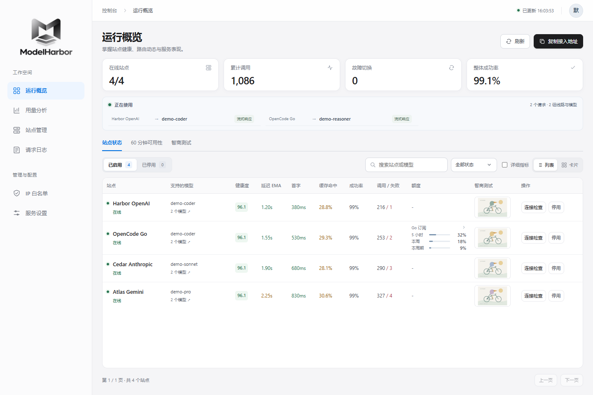
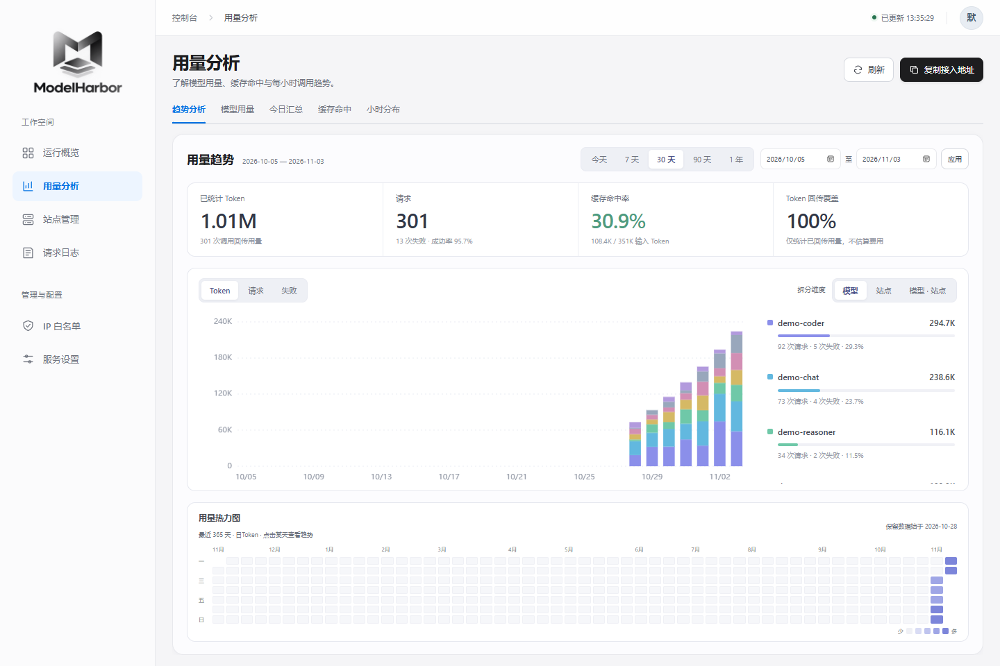
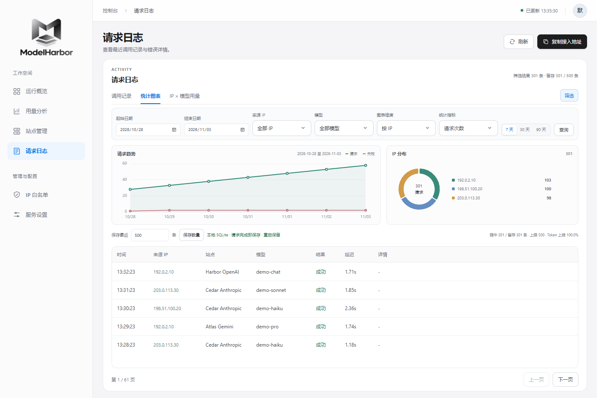
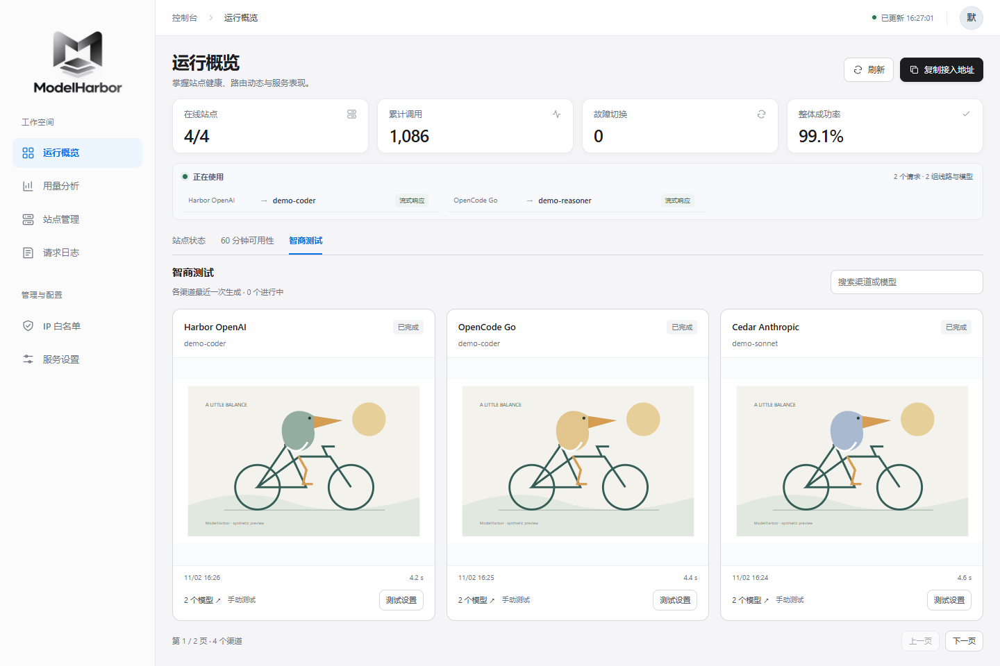

# ModelHarbor

轻量的多渠道模型网关：统一接入地址，按模型路由，在可用渠道之间自动切换。内置 Web 控制台，使用本地 SQLite 保存账号、请求统计和测试结果，无需额外数据库。

> **适用范围：个人自用、可信用户之间的小范围分发。** 当前账号用于切换配置空间，不是严格的多租户权限系统；持有管理密钥的人可以管理所有账号。若需要更严格的权限隔离、测试隔离或面向不可信用户的服务，需要二次开发和相应的安全审查。

## 功能

- **多协议接入**：OpenAI Responses / Chat Completions、Anthropic Messages、Gemini GenerateContent，支持流式响应。
- **模型与路由**：读取渠道模型目录，按精确模型 ID 和协议筛选；支持自动优先级、故障切换、限流冷却与熔断。
- **模型映射**：各账号按来源 IP 或所有请求配置替代模型，可选多个渠道；日志保留请求模型与实际模型，保存后热生效。
- **账号热切换**：对外地址保持不变，每个账号独立保存站点、IP 白名单和日志；切换可选账密验证。
- **可视化统计**：按时间、IP、模型和渠道查看请求与 Token；日志保留条数可配置，重启后恢复已保存数据。
- **按需测试**：连通性生成探测默认关闭；智商测试支持自定义提示词、模型和推理深度，预览 HTML / SVG，也可选择定时测试。
- **OpenCode Go**：独立计费入口与模型目录，展示上游提供的订阅用量，不自定义额度上限。
- **ChatGPT订阅**：官方 OAuth 接入 Plus / Pro 模型目录与 Responses API；可选连接 Codex 用量，并在官方支持时检测、确认使用重置卡。

## 界面预览

**运行概览** · 渠道状态、模型目录与用量集中展示。

**用量分析** · 按时间、模型与渠道查看 Token 趋势、分布和缓存命中。

**请求统计** · 按渠道、模型、IP 和时间查看最近保留的请求。

**智商测试** · 保存各渠道最近一次结果，直接预览生成页面。

## 快速部署

需要 **Python 3.11+**。克隆后任选一种方式启动：

**Windows / PowerShell**

~~~powershell
git clone https://github.com/Nikolu716/ModelHarbor.git
cd ModelHarbor
python -m venv .venv
./.venv/Scripts/python.exe -m pip install -r requirements.txt
Copy-Item config.example.yaml config.yaml
# 编辑 config.yaml，替换示例站点地址和 API Key
./.venv/Scripts/python.exe gateway.py
~~~

**Linux / macOS**

~~~bash
git clone https://github.com/Nikolu716/ModelHarbor.git
cd ModelHarbor
python3 -m venv .venv
. .venv/bin/activate
python -m pip install -r requirements.txt
cp config.example.yaml config.yaml
# 编辑 config.yaml，替换示例站点地址和 API Key
python gateway.py
~~~

控制台：`http://127.0.0.1:8000/dashboard`。默认只监听本机。

需要 Windows 后台服务时，在管理员 PowerShell 中运行 `./Install-ZGateway.ps1`，检查用 `./Verify-ZGateway.ps1`，卸载用 `./Uninstall-ZGateway.ps1`。脚本文件名保留兼容，实际服务名为 **ModelHarbor**。

## 开始使用

1. 打开控制台，在「站点管理」填写渠道地址与 Key，选择接口类型；读取模型目录后启用渠道。
2. 在「服务设置」填写客户端可访问的对外地址（包含实际端口），再使用右上角「复制接入地址」。远程访问前配置监听地址、当前账号的 IP 白名单、网关 API Key 和独立管理密钥。
3. 客户端使用网关地址、网关 Key 和渠道支持的模型 ID。不要把上游 Key 分发给客户端。

| 客户端协议 | 网关入口 |
| --- | --- |
| OpenAI | `/v1/responses`、`/v1/chat/completions` |
| Anthropic | `/v1/messages` |
| Gemini | `/v1beta/models/{model}:generateContent`、`:streamGenerateContent` |

默认路由保留请求模型；需要代答时，在「站点管理 → 模型映射」明确配置，例如 `gpt-6-sol → OpenCode Go / deepseek-v4.1-flash`。映射支持 OpenAI Responses / Chat，详见[匹配与兼容范围](docs/model-mappings.md)。OpenAI 客户端的 Base URL 通常填写 `http://你的主机:8000/v1`；其他客户端按其协议配置。

## 使用边界

- **账号切换是全局的**：影响后续进入网关的请求；已在执行的请求继续使用原账号。新账号从空站点、空白名单开始，本机 IP 也需显式加入。
- **测试可能计费**：模型目录读取与生成测试分开；目录可读不代表有调用额度。手动或定时生成测试会消耗上游额度，是否启用由用户决定。
- **统计不是账单**：Token 以响应上报为准；费用和订阅额度以上游为准。请求日志图表只统计最近保留的 N 条记录，按日用量单独保留。
- **预览不是完整隔离环境**：HTML / SVG 预览有限制，但不作为面向不可信内容的强安全边界；更严格的测试执行与资源隔离需要二次开发。
- **备份与迁移**：停止服务后一起备份 `config.yaml` 和整个 `data/`。使用单进程启动，勿让多个实例同时操作同一数据目录。
- **对外部署**：白名单按 TCP 来源 IP 判断。经反向代理时，应在代理层配置访问控制和 HTTPS；本机代理会影响来源识别，不能依赖转发头获得权限隔离。

## 更多说明

[更新记录](CHANGELOG.md) · [协议接入](docs/native-protocols.md) · [ChatGPT订阅](docs/chatgpt-subscription.md) · [OpenCode Go](docs/opencode-go.md) · [设置与统计](docs/dashboard-settings-and-statistics.md) · [开发与测试](CONTRIBUTING.md) · [安全说明](SECURITY.md)

本地配置、数据库、日志和真实测试结果不属于发布内容；仓库仅包含代码、示例配置及脱敏演示截图。

## 许可

[MIT](LICENSE)。第三方组件保留各自许可。
